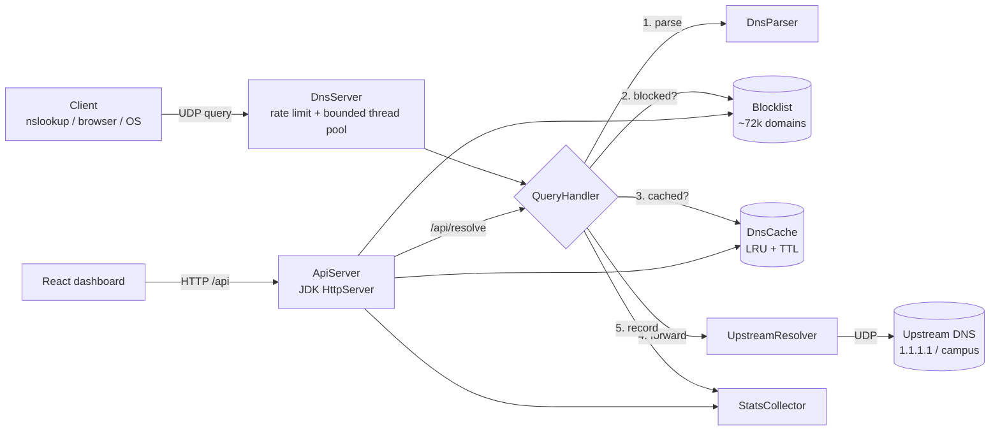

# DNS Filter — a mini Pi-hole in Java

A DNS server written from scratch in plain Java. It reads raw DNS packets off a UDP socket, blocks
ad / tracker / malware domains from a ~72,000-domain blocklist, caches answers in a hand-written
LRU + TTL cache, forwards everything else upstream, and shows live analytics on a React dashboard.

No frameworks: `DatagramSocket`, the JDK's built-in `HttpServer`, and Gson are the only building blocks.


**Stack:** Java 17 · Maven · JUnit 5 (73 tests) · React 18 + Vite + Recharts · Docker

---

## What it does

- **Parses DNS by hand (RFC 1035)**: header flags, label-encoded names, compression pointers, and
  A/AAAA/CNAME/NS/PTR/SOA records. Malformed packets get `FORMERR` instead of crashing a thread.
- **Blocks by domain and every subdomain**: blocking `doubleclick.net` also blocks `ad.doubleclick.net`.
  Reads plain, hosts-file and adblock (`||x^`) list formats, and downloads the StevenBlack list at startup.
- **Caches with real TTLs**: answers live for their record TTL. Remaining TTLs count down on cache
  hits. "Domain doesn't exist" answers are cached too (RFC 2308).
- **Defends itself**: checks that each upstream reply has the right ID and source, rate-limits each
  client IP, drops packets when overloaded, and validates all API input. Changes through the API
  can require an admin token.
- **Live dashboard**: traffic per minute, top domains / blocked / clients, p50/p95/p99 response
  time, a live query log, a "test a domain" box, and blocklist management. No restart needed.

## Architecture



One query, step by step (`server/QueryHandler.java`):

1. **Parse** the packet. Malformed → `FORMERR`; not a standard query → `NOTIMP`.
2. **Blocklist** check, walking parent domains (`a.b.ads.com` → `b.ads.com` → `ads.com`). Blocked →
   `NXDOMAIN` (or `0.0.0.0` in null-route mode). This runs *before* the cache, so a new block takes
   effect immediately even if the name is cached.
3. **Cache** lookup by `name:type`. Hit → the stored reply with the new transaction ID, the client's
   own name casing, and TTLs reduced by how long the entry has been stored.
4. **Forward** to the upstream (with fallback). Validate the reply, then cache it for
   `min(answer TTLs)`. Upstream timeout → `SERVFAIL`.
5. **Record** the outcome and latency for the dashboard.

More detail: [docs/ARCHITECTURE.md](docs/ARCHITECTURE.md).

## Benchmarks

Measured on my laptop (Windows, campus network) via the dashboard's resolve endpoint:

| Lookup | Path | Latency |
|---|---|---:|
| `google.com` (first time) | upstream (campus resolver) | 11.8 ms |
| `google.com` (again) | cache hit | **0.17 ms** (~70× faster) |
| `ad.doubleclick.net` | blocklist | < 0.1 ms once warm |

Load test, `scripts\benchmark.bat` (closed-loop UDP clients on the same machine):

| Scenario | Queries | Throughput | p50 | p95 | p99 | Timeouts |
|---|---:|---:|---:|---:|---:|---:|
| Cache hit | 20,000 | _run it_ | | | | |
| Blocked | 20,000 | | | | | |
| Cache miss (upstream) | 300 | | | | | |

> Run `scripts\benchmark.bat` with the server running and paste the Markdown table it prints here.

## Run it (Windows)

Prerequisites: JDK 17+, Maven, Node 18+.

**Development** (hot-reloading dashboard):
```bat
scripts\run-backend.bat      :: DNS on UDP 5300, API on http://localhost:8081/api
scripts\run-frontend.bat     :: dashboard on http://localhost:5173
```

**One process** (built dashboard served by the Java server):
```bat
scripts\build-prod.bat       :: dashboard + API on http://localhost:8081, DNS on UDP 5300
```

**Docker:**
```bash
docker compose up --build    # dashboard on http://localhost:8081, DNS on UDP 5300
```

**Try it:**
```bat
nslookup -port=5300 google.com 127.0.0.1           :: forwarded, then cached
nslookup -port=5300 ad.doubleclick.net 127.0.0.1   :: blocked -> Non-existent domain
powershell -ExecutionPolicy Bypass -File scripts\test-dns.ps1
powershell -ExecutionPolicy Bypass -File scripts\test-api.ps1
scripts\benchmark.bat
```

To filter your whole machine: set `dns.port=53` (run as Administrator) and point your network
adapter's DNS at `127.0.0.1`. Switch it back when you stop the server.

## Configuration

`backend/src/main/resources/config.properties`. Any key can be overridden with an environment
variable, `DNSFILTER_` + the key in capitals with dots → underscores (for example
`DNSFILTER_UPSTREAM_HOST=1.1.1.1`), or a `-Dkey=value` JVM flag.

| Key | Default | Meaning |
|---|---|---|
| `dns.port` | `5300` | UDP port (53 needs admin/root) |
| `upstream.host` / `upstream.fallback` | campus resolver / `1.1.1.1,8.8.8.8` | where cache misses go; whichever answers is tried first from then on |
| `upstream.timeoutMs` | `1500` | per-upstream timeout before `SERVFAIL` |
| `cache.maxEntries` / `cache.maxTtl` / `cache.negativeTtl` | `1000` / `86400` / `300` | cache size and TTL caps |
| `blocklist.files` / `allowlist.file` | `../blocklists/*.txt` | local lists; category = file name |
| `blocklist.remote` | StevenBlack hosts | `category\|url` lists downloaded at startup, cached 24 h |
| `blocking.mode` | `nxdomain` | or `nullroute` (answer `0.0.0.0` / `::`) |
| `dns.rateLimit.qps` / `.burst` | `50` / `100` | per-client token bucket; `0` disables |
| `api.port` / `api.bind` | `8081` / `0.0.0.0` | REST API + dashboard |
| `api.token` | empty | admin token for POST/DELETE; set via `DNSFILTER_API_TOKEN` |
| `api.corsOrigin` | `*` | allowed browser origin |

## REST API

| Method | Path | |
|---|---|---|
| GET | `/api/stats` | totals, block %, cache hit ratio, latency p50/p95/p99, uptime |
| GET | `/api/queries?limit=&status=&search=` | recent query log, newest first |
| GET | `/api/top?n=10` | top domains, top blocked, top clients, blocked by category |
| GET | `/api/timeseries` | queries per minute, last 60 minutes |
| GET | `/api/resolve?name=&type=A` | resolve through the real pipeline (rate-limited) |
| GET | `/api/blocklist[?domain=]` | list summary, or whether a domain is blocked and why |
| POST / DELETE | `/api/blocklist` | add `{domain, category}` / remove `?domain=` 🔒 |
| GET / POST / DELETE | `/api/allowlist` | view / add / remove 🔒 |
| GET / DELETE | `/api/cache` | cache stats / flush 🔒 |

🔒 needs `Authorization: Bearer <token>` when a token is configured. Errors are JSON
(`{"error": "..."}`) with the right status code: 400, 401, 404, 405, 413 or 429.

## Tests

`cd backend && mvn test` runs 73 tests:

- **Parser**: truncated packets, compression-pointer loops, forward pointers, lying counts.
- **Caches**: LRU eviction order, concurrent access, TTL expiry with a fake clock, TTL countdown.
- **Blocklist**: all three list formats, parent matching on label boundaries, allowlist precedence.
- **Resolver**: spoofed wrong-ID replies ignored, timeout, fallback, against a fake upstream on localhost.
- **Pipeline**: block-before-cache, negative caching, `SERVFAIL`, `FORMERR`.
- **Stats**: top-N heap against a full sort, percentiles, time-series bucketing, concurrency.
- **REST API**: tested over real HTTP, including validation, auth, rate limits, static files and
  path-traversal attempts.

## Project layout

```
backend/     Java DNS server + REST API (Maven)
  protocol/  packet parsing & building    cache/   LRU + TTL cache
  filter/    blocklists                   resolver/ upstream forwarding
  server/    UDP loop, pipeline, limiter  stats/   counters, top-N, time series
  api/       REST API + static files      bench/   load generator
frontend/    React dashboard (Vite)
blocklists/  ads / trackers / malware / allowlist
scripts/     run, build, test and benchmark helpers (Windows)
docs/        ARCHITECTURE.md, DEPLOY.md
```

## Deploying

See [docs/DEPLOY.md](docs/DEPLOY.md): an Oracle Cloud Always Free VM with Docker, Caddy for HTTPS,
and a firewall so it never becomes an open resolver.
