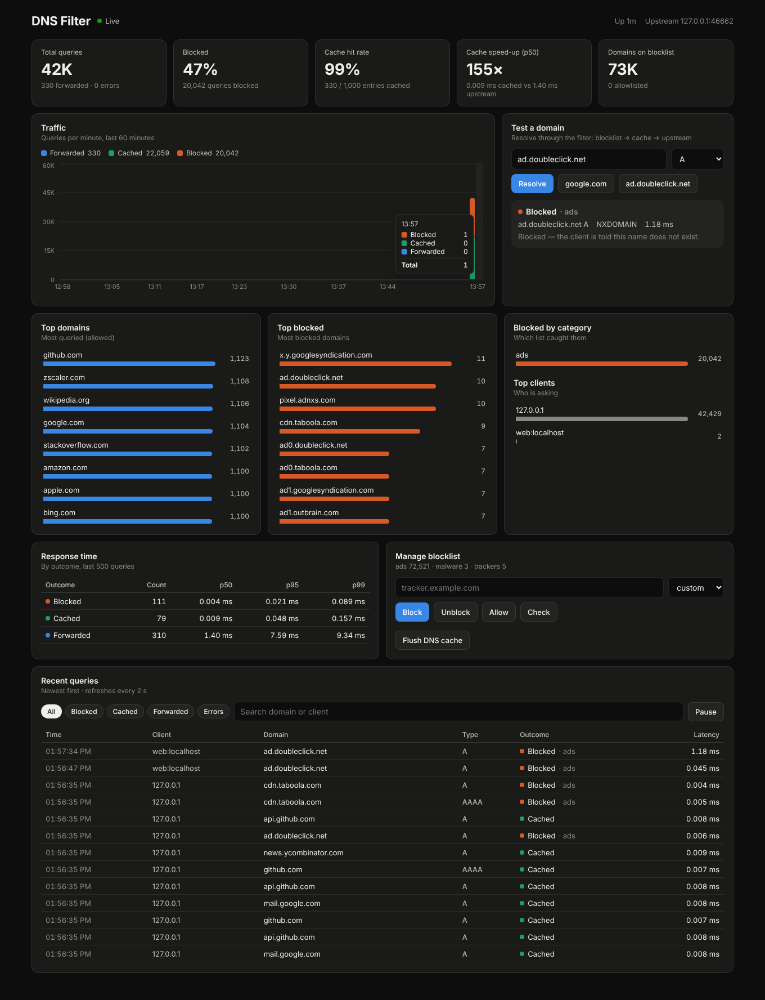
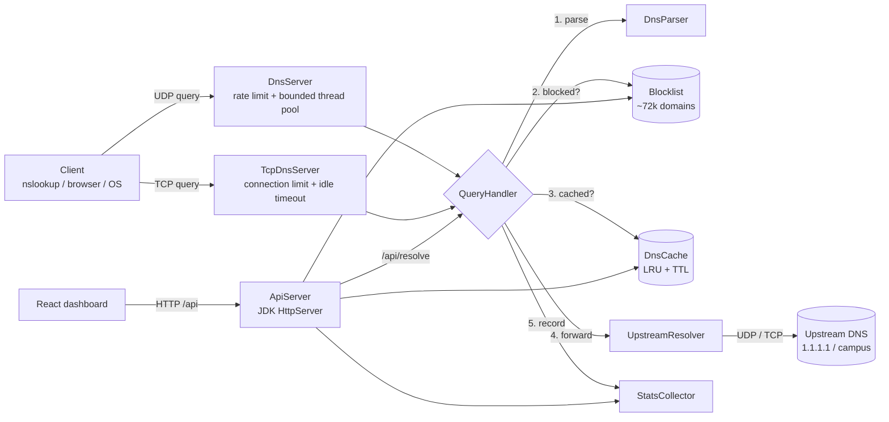

# DNS Filter — a mini Pi-hole in Java

A DNS server written from scratch in plain Java. It reads raw DNS packets off UDP and TCP sockets, blocks
ad / tracker / malware domains from a ~72,000-domain blocklist, caches answers in a hand-written
LRU + TTL cache, forwards everything else upstream, and shows live analytics on a React dashboard.

No frameworks: `DatagramSocket`, the JDK's built-in `HttpServer`, and Gson are the only building blocks.



**Stack:** Java 17 · Maven · JUnit 5 (113 tests) · React 18 + Vite + Recharts · Docker

---

## What it does

- **Parses DNS by hand (RFC 1035)**: header flags, label-encoded names, compression pointers, and
  A/AAAA/CNAME/NS/PTR/SOA records. Malformed packets get `FORMERR` instead of crashing a thread.
- **Speaks UDP and TCP**: answers too big for the client's UDP limit (512 bytes, or its EDNS size)
  come back truncated (TC=1), and the client retries over TCP on the same port, where big TXT and
  DNSSEC answers arrive whole.
- **Blocks by domain and every subdomain**: blocking `doubleclick.net` also blocks `ad.doubleclick.net`.
  Reads plain, hosts-file and adblock (`||x^`) list formats, downloads the StevenBlack list, and
  re-downloads it every 24 h while running (or on demand from the dashboard).
- **Remembers your edits**: blocks, unblocks and allows made from the dashboard are saved to
  `data/overrides.txt` and survive restarts and list refreshes. Dashboard totals, top lists and the
  query log are saved to `data/stats.json`.
- **Caches with real TTLs**: answers live for their record TTL. Remaining TTLs count down on cache
  hits. "Domain doesn't exist" answers are cached too (RFC 2308). Plain, EDNS and DNSSEC-OK queries
  get separate cache entries.
- **Defends itself**: sends its own random transaction ID upstream from a random port, and only
  accepts a reply with that ID, from that server, for that question. Rate-limits each client IP,
  drops packets when overloaded, and validates all API input.
- **Safe dashboard by default**: the API listens on localhost only and refuses to listen anywhere
  else without an admin token. It also rejects cross-site browser requests and DNS-rebinding
  tricks, so a web page you visit can't read your query log or edit your lists. See
  [Security](#security).
- **Live dashboard**: traffic per minute, top domains / blocked / clients, p50/p95/p99 response
  time, a live query log, a "test a domain" box, and blocklist management. No restart needed.

## Architecture



One query, step by step (`server/QueryHandler.java`):

1. **Parse** the packet. Malformed → `FORMERR`; not a standard query → `NOTIMP`.
2. **Blocklist** check, walking parent domains (`a.b.ads.com` → `b.ads.com` → `ads.com`). Blocked →
   `NXDOMAIN` (or `0.0.0.0` in null-route mode). This runs *before* the cache, so a new block takes
   effect immediately even if the name is cached.
3. **Cache** lookup by `name:type` (+ EDNS variant). Hit → the stored reply with the new
   transaction ID, the client's own name casing, and TTLs reduced by how long the entry has been stored.
4. **Forward** to the upstream (with fallback; over TCP if the client came over TCP). Validate the
   reply, then cache it for `min(answer TTLs)`. Upstream timeout → `SERVFAIL`.
5. **Fit** the reply to the client: over UDP, anything bigger than its limit becomes an empty
   TC=1 reply so it retries over TCP.
6. **Record** the outcome and latency for the dashboard.

More detail: [docs/ARCHITECTURE.md](docs/ARCHITECTURE.md).

## Benchmarks

Measured on my laptop (Windows, campus network) via the dashboard's resolve endpoint:

| Lookup | Path | Latency |
|---|---|---:|
| `google.com` (first time) | upstream (campus resolver) | 11.8 ms |
| `google.com` (again) | cache hit | **0.17 ms** (~70× faster) |
| `ad.doubleclick.net` | blocklist | < 0.1 ms once warm |

Load test, `scripts\benchmark.bat` (16 closed-loop UDP clients on the same machine; Windows 11,
16 cores, Java 17). Localhost was *not* exempt from rate limiting for this run (limits set very
high), so every packet went through the per-client and global limiters:

| Scenario | Queries | Throughput | p50 | p95 | p99 | Timeouts |
|---|---:|---:|---:|---:|---:|---:|
| Cache hit | 20,000 | 60,460 q/s | 0.194 ms | 0.515 ms | 0.649 ms | 0 |
| Blocked | 20,000 | 64,494 q/s | 0.177 ms | 0.500 ms | 0.569 ms | 0 |

Runs vary: the first run after startup is slower (JIT warm-up, lost loopback packets).

The benchmark's third scenario (cache misses: 300 unique random names sent upstream) depends
entirely on the upstream. On the campus network the resolver didn't answer those synthetic names
in time, so that row only measured timeouts and is left out. Real names went upstream in 5–60 ms.

## Run it (Windows)

Prerequisites: JDK 17+, Maven, Node 18+.

**Development** (hot-reloading dashboard):
```bat
scripts\run-backend.bat      :: DNS on port 5300 (UDP + TCP), API on http://localhost:8081/api
scripts\run-frontend.bat     :: dashboard on http://localhost:5173
```

**One process** (built dashboard served by the Java server):
```bat
scripts\build-prod.bat       :: dashboard + API on http://localhost:8081, DNS on port 5300
```

**Docker:**
```bash
docker compose up --build    # dashboard on http://localhost:8081 (this machine only), DNS on 5300
```

**Try it:**
```bat
powershell -ExecutionPolicy Bypass -File scripts\raw-query.ps1 google.com          :: forwarded, then cached
powershell -ExecutionPolicy Bypass -File scripts\raw-query.ps1 ad.doubleclick.net  :: blocked -> rcode=3
powershell -ExecutionPolicy Bypass -File scripts\test-dns.ps1
powershell -ExecutionPolicy Bypass -File scripts\test-api.ps1
scripts\benchmark.bat
```

`nslookup -port=5300 google.com 127.0.0.1` also works on many systems, but some Windows 11 builds
of `nslookup` ignore `-port=` and only ever talk to port 53. The scripts above use a plain socket.

To filter your whole machine: set `dns.port=53` in `backend\config.local.properties` (run as
Administrator) and point your network adapter's DNS at `127.0.0.1`. Switch it back when you stop
the server.

## Configuration

Defaults live in `backend/src/main/resources/config.properties`. Settings for just your machine
go in `backend/config.local.properties` (git-ignored; see `config.local.properties.example`).
On a network that blocks outside DNS, such as campus Wi-Fi, put the network's resolver there:
`upstream.host=172.17.18.2`. Any key can also be overridden with an environment variable,
`DNSFILTER_` + the key in capitals with dots → underscores (for example
`DNSFILTER_UPSTREAM_HOST=1.1.1.1`), or a `-Dkey=value` JVM flag.

| Key | Default | Meaning |
|---|---|---|
| `dns.port` | `5300` | UDP + TCP port (53 needs admin/root) |
| `dns.tcp.enabled` / `.maxConnections` / `.maxConnectionsPerClient` | `true` / `64` / `8` | DNS over TCP |
| `dns.tcp.idleTimeoutMs` / `.messageTimeoutMs` / `.writeTimeoutMs` | `10000` / `2000` / `5000` | TCP Slowloris limits |
| `dns.maxUdpSize` | `1232` | largest UDP reply, whatever EDNS asks for |
| `upstream.host` / `upstream.fallback` | `1.1.1.1` / `8.8.8.8,9.9.9.9` | where cache misses go; whichever answers is tried first from then on |
| `upstream.timeoutMs` | `1500` | per-upstream timeout before `SERVFAIL` |
| `upstream.maxInFlight` | `12` | upstream lookups at once (keep below `dns.workers`); more → instant `SERVFAIL` |
| `cache.maxEntries` / `cache.maxTtl` / `cache.negativeTtl` | `1000` / `86400` / `300` | cache size and TTL caps |
| `blocklist.files` / `allowlist.file` | `../blocklists/*.txt` | local lists; category = file name |
| `blocklist.remote` | StevenBlack hosts | `category\|url` lists, downloaded and cached on disk |
| `blocklist.refreshHours` | `24` | re-download remote lists this often while running; `0` = startup only |
| `blocklist.overridesFile` | `../data/overrides.txt` | where dashboard edits are saved |
| `stats.file` / `stats.saveIntervalSec` | `../data/stats.json` / `300` | saved dashboard numbers; empty = don't save |
| `blocking.mode` | `nxdomain` | or `nullroute` (answer `0.0.0.0` / `::`) |
| `dns.rateLimit.qps` / `.burst` | `50` / `100` | per-client token bucket, shared by UDP and TCP; `0` disables |
| `dns.rateLimit.maxClients` | `10000` | client IPs the limiter remembers (LRU) |
| `dns.rateLimit.globalQps` / `.globalBurst` | `2000` / `4000` | total queries/s across all clients; `0` disables |
| `api.maxConnections` / `api.maxHeaderSec` / `api.maxResponseSec` | `100` / `10` / `30` | HTTP server limits |
| `api.port` / `api.bind` | `8081` / `127.0.0.1` | REST API + dashboard |
| `api.token` | empty | admin token; set via `DNSFILTER_API_TOKEN`. Required to bind beyond localhost |
| `api.publicReads` | `false` | `true` = GET endpoints stay public even with a token (demo only) |
| `api.allowedHosts` | empty | extra host names the dashboard may be opened by without a token |
| `api.corsOrigin` | empty | a different origin allowed to call the API (`*` needs a token) |
| `api.insecure` | `false` | allow a non-localhost bind without a token (see docker-compose.yml) |

## Security

The query log is your browsing history, and the lists decide what resolves, so the API is locked
down by default:

- **Localhost only.** `api.bind=127.0.0.1`. Binding to any other address without `api.token`
  makes the server refuse to start.
- **Token covers reads too.** With a token set, every endpoint except `/api/health` needs
  `Authorization: Bearer <token>`. The dashboard asks for it once and keeps it in the browser.
  `api.publicReads=true` re-opens the GETs for a public demo.
- **No cross-site requests.** A POST or DELETE whose `Origin` is another site gets 403. POST bodies
  must be `application/json`, which a plain HTML form can't send. CORS headers are only sent for
  the one origin in `api.corsOrigin`.
- **No DNS rebinding.** Without a token, the `Host` header must be an IP address, `localhost`, or
  a name in `api.allowedHosts`. Otherwise `evil.example`, re-pointed at 127.0.0.1, would count as
  "same origin".
- **Upstream anti-spoofing.** Each upstream query gets a fresh random transaction ID from
  `SecureRandom` and a random source port. A reply must match the ID, the server and the question.

### Floods and DoS

No program can absorb a real DDoS: thousands of machines fill the network link before a packet
reaches Java. That needs the firewall (port 5300 open to your own IP only, see
[DEPLOY.md](docs/DEPLOY.md)) and your provider's network-level filtering. What the server does is
stay up, stay fast for normal clients, and not serve as an amplifier:

| Attack | Defense |
|---|---|
| One client flooding | Per-IP token bucket (50/s, burst 100); extra packets are dropped, nothing is reflected |
| Flood from random spoofed IPs | Limiter remembers at most 10,000 IPs (LRU): constant memory, one hash lookup per packet. A global cap (2,000/s) holds no matter how many addresses |
| Using us to amplify an attack on someone else | Dropped instead of answered when over the limit; UDP replies capped at 1,232 bytes even if EDNS asks for more (≈20× instead of 68×) |
| More packets than workers | Bounded queue; overflow is dropped and counted |
| Flood of never-seen names (random subdomains) | At most 12 upstream lookups in flight; the rest get SERVFAIL at once, so cached and blocked names keep answering in microseconds |
| Slow TCP clients (Slowloris) | ≤64 connections, ≤8 per IP; 10 s idle limit; a started query must fully arrive within 2 s; a client that stops reading replies is cut off after 5 s |
| Slow HTTP clients | ≤100 connections; request headers within 10 s; bodies are only read after the token check |

## REST API

| Method | Path | |
|---|---|---|
| GET | `/api/stats` | totals, block %, cache hit ratio, latency p50/p95/p99, uptime |
| GET | `/api/queries?limit=&status=&search=` | recent query log, newest first |
| GET | `/api/top?n=10` | top domains, top blocked, top clients, blocked by category |
| GET | `/api/timeseries` | queries per minute, last 60 minutes |
| GET | `/api/resolve?name=&type=A` | resolve through the real pipeline (rate-limited) |
| GET | `/api/blocklist[?domain=]` | list summary, or whether a domain is blocked and why |
| POST / DELETE | `/api/blocklist` | add `{domain, category}` / remove `?domain=` 🔒 |
| POST | `/api/blocklist/reload` | re-download remote lists, re-read local files 🔒 |
| GET / POST / DELETE | `/api/allowlist` | view / add / remove 🔒 |
| GET / DELETE | `/api/cache` | cache stats / flush 🔒 |
| GET | `/api/health` | always open, for monitoring |

When a token is configured, every endpoint except `/api/health` needs `Authorization: Bearer <token>`.
🔒 marks the ones that still need it with `api.publicReads=true`. Errors are JSON
(`{"error": "..."}`) with the right status code: 400, 401, 403, 404, 405, 413, 415 or 429.

## Tests

`cd backend && mvn test` runs 113 tests:

- **Parser**: truncated packets, compression-pointer loops, forward pointers, lying counts.
- **Protocol helpers**: EDNS size and DO-bit detection, truncated replies, question matching.
- **Caches**: LRU eviction order, concurrent access, TTL expiry with a fake clock, TTL countdown.
- **Blocklist**: all three list formats, parent matching on label boundaries, allowlist precedence,
  saved overrides surviving a restart and a list refresh, atomic reload.
- **Resolver**: spoofed wrong-ID and wrong-question replies ignored, our own random ID upstream,
  TCP forwarding, timeout, retransmit, fallback, against a fake upstream on localhost.
- **Pipeline**: block-before-cache, negative caching, EDNS cache variants, truncation for UDP,
  the upstream in-flight cap failing fast, `SERVFAIL`, `FORMERR`.
- **Rate limiting**: token buckets, LRU bound under a million spoofed addresses, the global cap
  holding when every packet has a different source, loopback exemption.
- **Servers**: the real UDP and TCP listeners: TC=1 over UDP then the full answer over TCP, the
  1,232-byte UDP cap, several queries on one TCP connection, the per-client connection cap, a
  drip-fed query cut off at its deadline, a client that never reads replies being disconnected,
  garbage packets, clean stop.
- **Stats**: top-N heap against a full sort, percentiles, time-series bucketing, concurrency, save
  and restore.
- **REST API**: tested over real HTTP, including validation, auth on reads and writes, cross-site
  requests, DNS rebinding Host headers, refusing a non-local bind without a token, CORS, rate
  limits, HTTP server limits and stalled-header connections, static files and path-traversal attempts.

## Project layout

```
backend/     Java DNS server + REST API (Maven)
  protocol/  packet parsing & building    cache/   LRU + TTL cache
  filter/    blocklists                   resolver/ upstream forwarding
  server/    UDP + TCP, pipeline, limiter stats/   counters, top-N, time series, save
  api/       REST API + static files      bench/   load generator
frontend/    React dashboard (Vite)
blocklists/  ads / trackers / malware / allowlist
data/        overrides.txt + stats.json, written at runtime (git-ignored)
scripts/     run, build, test and benchmark helpers (Windows)
docs/        ARCHITECTURE.md, DEPLOY.md
```

## Deploying

See [docs/DEPLOY.md](docs/DEPLOY.md): an Oracle Cloud Always Free VM with Docker, Caddy for HTTPS,
and a firewall so it never becomes an open resolver.
